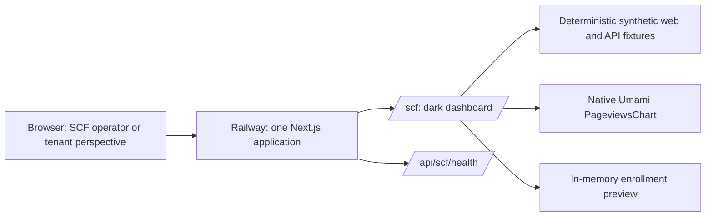
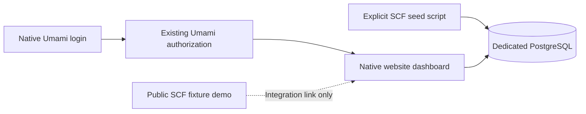

# POC architecture

This fork extends Umami 3.5.0 with an SCF demonstration experience. It intentionally keeps the deployment small: one Next.js application, a deterministic fixture generator and an optional ordinary PostgreSQL database for the native Umami screens.

## Live demo

The fixture dataset is bundled in the application. The perspective selector filters public synthetic data in the browser and is not a security boundary. No OpenTelemetry collector, real event ingestion, Redis, HA replica or external analytics database is required for this experience.

Enrollment adds an empty project to React state. A refresh resets those additions. Export downloads synthetic JSON for the selected scope and time range. Demo state is not stored on the server.

The global perspective also contains a dedicated SCF administration dashboard. It computes per-project metrics from the same fixture helpers and offers data-management shortcuts. The Data & privacy screen adds tenant-scoped erasure masks, project removal and a session-only activity log. All dashboard calculations and exports use the masks. Erasing analytics preserves the project IDs; removing a project excludes it from every scope. Refresh restores the initial state.

An exact-name confirmation and a reason are required. Pure management helpers reject actions for another tenant in a tenant perspective, but these are client-side UX guards, not authentication. No demo action calls native Umami deletion APIs or mutates PostgreSQL. The activity log retains project labels/reasons for this session, including after project removal; it is not a durable production audit system.

## Native Umami option

The native option uses the existing Umami models and migrations. The seed adds accounts and web events; it does not add schema or bypass native authorization. It requires an explicit seed password and a database dedicated to the POC. Native login and the public perspective switch remain separate experiences.

| Contract | Representation |
| --- | --- |
| `tenant.id` | Existing Umami `Team.id` UUID |
| Website ownership | `Website.teamId` points to that team |
| Tenant membership | `User` plus `TeamUser` |
| Operator | Native Umami admin account |
| Web activity | `Session` plus `WebsiteEvent`, pageviews with `eventType=1` |
| API activity | Synthetic rows attributed by tenant, service and normalized route |

## Data calculations

Fixtures depend on a project's seed and the UTC date. Seven- and thirty-day ranges are subsets of the same ninety-day generator. Global counts are sums of project counts.

Synthetic visits use one session per visit. Visitors are counted per day and summed across the range, not deduplicated people across days. Page counts and geographic/browser/device/referrer breakdowns are derived from those same visits. Native Umami retains its own metric definitions and timezone behavior.

API status counts and histogram populations sum to request counts. Quantiles are upper-bound bucket estimates. Global latency quantiles are computed after merging histograms; tenant percentiles are not averaged.

The fixed path normalizer removes queries/fragments, collapses trailing/repeated slashes and replaces numeric IDs, UUIDs, long hexadecimal hashes and Stellar G/C/M address-shaped segments with placeholders. It is a demonstration of the metric contract, not a production ingestion service or address validator.

## Implementation map

| Path | Purpose |
| --- | --- |
| `src/app/scf/` | Dashboard UI, styling and server-side demo gate |
| `src/lib/scf/demo.ts` | Shared deterministic dataset and normalization/calculation helpers |
| `src/lib/scf/demo.test.ts` | Analytics, tenant attribution and data-erasure invariants |
| `src/lib/scf/management.ts` | Demo erasure/project-removal actions, impact calculations and session activity records |
| `src/app/scf/AdminDashboard.tsx` | SCF operator oversight and activity log |
| `src/app/scf/DataManagement.tsx` | Tenant/operator data controls and confirmation dialogs |
| `src/app/api/scf/health/route.ts` | Application health for demo deployments |
| `src/app/UmamiRootPage.tsx` | Preserved original Umami root behavior |
| `scripts/dev-scf.mjs` | Database-free local development entry |
| `scripts/start-scf.mjs` | Standalone runtime bootstrap |
| `scripts/seed-scf-demo.ts` | Optional additive native Umami seed |
| `Dockerfile.poc` | Dedicated production demo container |

## Production boundary

High availability is an intended future capability. It is not provided or measured by the current single-instance deployment. Production work also includes authenticated ingestion, SCF-specific authorization, strict tenant database isolation, persistent onboarding, immutable tracker releases, privacy controls and operational monitoring.

The [technical guide](SCF-POC.md) describes the demo walkthrough, configuration and remaining work. AWS, EC2 and any particular hosting region are not part of the POC contract.
